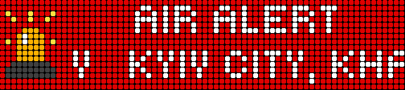
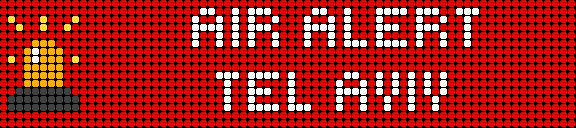
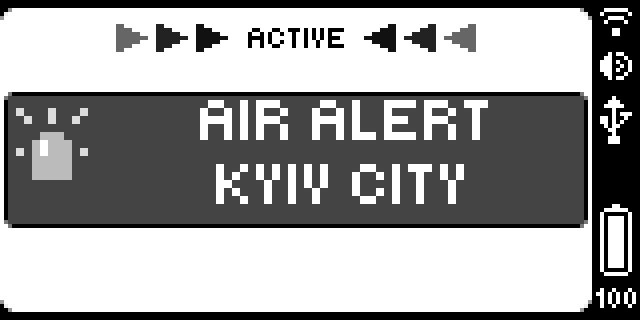
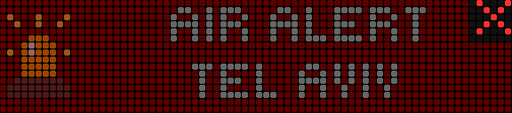
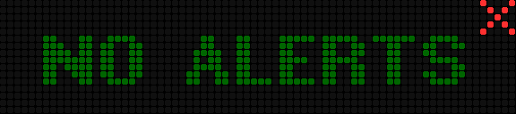

# Air Raid Alert

Air raid alerts for regions of Ukraine and cities of Israel.


Pick up to three regions of Ukraine and up to three cities of Israel in the settings. While none of them is under alert, the bar shows a green NO ALERTS; when an alert begins, the front display turns red with a flashing siren and the region's name, the siren sounds and the status light blinks red.

A JavaScript app for [BUSY Bar](https://busy.app).

## What the bar shows

With every region and city set to None, the front display says SET REGION and the app asks no source.


Until the first answer comes, the front display shows `--`. While none of the picked regions is under alert, it shows NO ALERTS in green.


When an alert begins in a picked region, the front display turns red, a siren flashes on the left, and AIR ALERT with the region's name stands on the right. The siren sound plays and the status light blinks red, and they do so again whenever another picked region joins the alert.

Several regions under alert scroll one after another, and so does one long name, IVANO-FRANKIVSK or DNIPROPETROVSK.



A city of Israel is under alert when any of its parts is. Israel (any alert), picked in a region field, shows ISRAEL during any alert in Israel.



The app draws nothing on the back display, so the BUSY Bar shows its own screen there: ACTIVE over a copy of the front display.



When the last alert ends, ALL CLEAR shows in green for a minute, then NO ALERTS.


When a source does not answer, the front display keeps its last answer, dimmed, with a red cross in the top right corner: the alert with the siren standing still, or NO ALERTS. An alert from a source that did answer still shows in full, with the cross.





With no earlier answer kept for the regions picked now, the `--` stays, with the red cross.


## Buttons

| Button | What it does |
| --- | --- |
| Back | Quits the app. |

## Settings

| Setting | What it does |
| --- | --- |
| Region 1, Region 2, Region 3 | A region of Ukraine: Kyiv (city), Kyiv oblast or one of the other 22 oblasts, or Israel (any alert); None leaves the field unused. Region 1 is Kyiv (city) by default, the others None. |
| Israeli city 1, Israeli city 2, Israeli city 3 | One of 31 cities of Israel, from Ashdod to Tel Aviv, with alerts in any of its parts; None leaves the field unused. None by default. |

Luhansk oblast and Sevastopol are not in the list: their records at the source have said "alert" since 2022. The app reads its settings when it starts.

## Data

[ubilling.net.ua aerial alerts](https://ubilling.net.ua/aerialalerts/) for Ukraine and the list of current alerts of [Tzeva Adom](https://www.tzevaadom.co.il) for Israel, no keys needed. Every 20 seconds the app asks each source that the picked regions need. It keeps the last answer in its local storage on the BUSY Bar, to show it dimmed when the sources do not answer.

## Build

Node 24 and npm:

```sh
npm ci
npm run build         # dist/io.github.vvzvlad.airalert.tgz
npm run app:install   # install it on a BUSY Bar connected over USB
npm run app:run       # start it
```

## License

[MIT](LICENSE)
